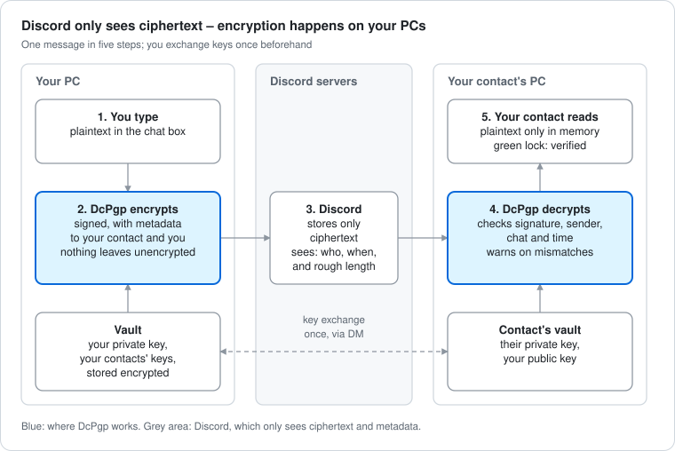

# DcPgp (dcpgp/1)

[](https://github.com/Algonilol/dc-pgp/actions/workflows/test.yml)
[](https://github.com/Algonilol/dc-pgp/releases/latest)
[](LICENSE)

End-to-end encrypted direct messages for Discord, as a [Vencord](https://vencord.dev) userplugin.

Discord already encrypts voice and video calls end-to-end – but not your text messages. DcPgp closes that gap: messages are signed and encrypted with OpenPGP on your PC before they reach Discord, so Discord only ever stores ciphertext. Your contact's plugin decrypts it and shows the plaintext in place of the PGP block, with a lock icon that tells you whether the sender is verified.

> [!WARNING]
> **Experimental, so far tested only by its author, and not independently audited.** Client mods like Vencord are against Discord's Terms of Service. Read [what it does not protect](#what-it-does-not-protect) before you rely on it. Use at your own risk – see the [disclaimer](#disclaimer).



## Contents

- [Features](#features)
- [What it does not protect](#what-it-does-not-protect)
- [Installation (Windows)](#installation-windows)
- [Getting started](#getting-started)
- [Settings](#settings)
- [Security notes](#security-notes)
- [Known limitations](#known-limitations)
- [Development](#development)
- [Feedback and contributing](#feedback-and-contributing)
- [Disclaimer](#disclaimer)
- [License](#license)

More details: [PROTOCOL.md](PROTOCOL.md) (wire format, key lifetime, vault) · [SECURITY.md](SECURITY.md) (threat model, reporting vulnerabilities) · [CONTRIBUTING.md](CONTRIBUTING.md) · [CHANGELOG.md](CHANGELOG.md) (what changed in each version)

## Features

- **End-to-end encryption and signatures** with OpenPGP (Curve25519 keys, AES-256), compatible with GnuPG and Kleopatra.
- **Key exchange inside Discord**: a key request is an ordinary message; your contact accepts it with one click on the card under it. If you both send a request at the same time, the exchange completes on its own.
- **Verification with safety numbers**: 60 digits you compare once on a call or in person. Key changes are never accepted silently.
- **Keys that don't run out**: a year before your key expires, DcPgp extends it – same key, same safety number. Your contacts receive the update automatically.
- **Made for 1:1 DMs**; group DMs and server channels work too: each message is readable for everyone in the chat whose key you have.
- **Signed metadata inside the encryption** (sender, chat, recipients, time) exposes re-posted, forwarded or replayed messages.
- **Fail-closed send protection**: in an encrypted chat nothing leaves unencrypted. The plugin is the first pre-send hook, an emergency brake guards Discord's own send and edit functions, drafts of encrypted chats are never written to disk, and a check verifies that your own messages arrive at Discord encrypted.
- **Local vault** for your key and contacts (AES-256-GCM), unlocked with a password (Argon2id, 256 MiB) and bound to your PC through Windows DPAPI – or "RAM only" mode, where nothing secret is stored and you unlock with your key file.
- **Automatic locking** after a period without input and when Windows locks or goes to sleep. Locking discards your key and all decrypted text.
- **Portable vault backup** to move to another PC.
- Decrypted text is only rendered in the UI; it never enters Discord's message store.
- **View Raw PGP**: while locked, see and copy the exact encrypted block of a DM message, e.g. to decrypt it in Kleopatra.
- What DcPgp copies for you (ciphertext, your private key) is cleared from the clipboard after a set time.
- Optional blur for screen sharing, a per-chat "decrypt automatically" switch, and a mark on unencrypted messages in encrypted chats.

## What it does not protect

- **Metadata**: Discord still sees who writes to whom, when, and roughly how long each message is.
- **Anything but message text**: attachments, embeds, reactions, polls and voice are not encrypted. Attachments and polls are blocked in encrypted chats.
- **A compromised PC** (malware, keyloggers) or a malicious Discord client update.
- **The other person**: they can screenshot or forward what they decrypted.
- **People without the plugin** – including Discord on mobile – only see ciphertext.
- **No forward secrecy**: whoever obtains your private key and old ciphertext can read old messages.

## Installation (Windows)

You need the Discord desktop app, [Git](https://git-scm.com) and [Node.js](https://nodejs.org) 20.11 or newer. If you don't have them yet: `winget install Git.Git` and `winget install OpenJS.NodeJS.LTS`, then open a new PowerShell window. Custom plugins require building Vencord from source; see Vencord's guide on [installing custom plugins](https://docs.vencord.dev/installing/custom-plugins/).

### Quick install

Open a normal PowerShell window (**not as administrator**) and run:

```powershell
irm https://raw.githubusercontent.com/Algonilol/dc-pgp/main/install.ps1 | iex
```

The [installer](install.ps1) checks Git and Node.js, downloads Vencord and DcPgp into your user folder, builds them, finds your Discord and patches it, and offers to restart Discord for you. DcPgp switches itself on. To update, run the same command again. It is short, so you can read it before you run it.

### Manual install

The same steps by hand, in a normal PowerShell window (**not as administrator**): it starts in your user folder, where they can create the `Vencord` folder.

```powershell
git clone https://github.com/Vendicated/Vencord
cd Vencord
git clone https://github.com/Algonilol/dc-pgp.git src/userplugins/dcPgp.desktop
cd src/userplugins/dcPgp.desktop
npm ci --omit=dev
cd ../../..
corepack pnpm install --frozen-lockfile
corepack pnpm build
corepack pnpm inject
```

Quit Discord completely (also in the system tray) and start it again. DcPgp switches itself on; you find it under *Settings → Vencord → Plugins*.

- **Why npm and pnpm:** the plugin brings its own libraries (OpenPGP.js and others), installed with `npm ci` in its folder; `--omit=dev` leaves out the test tools you don't need. Vencord itself is built with pnpm. If pnpm suggests an update, ignore it: Vencord sets the pnpm version it needs.
- **Names:** this repository is `dc-pgp`, the folder must be called `dcPgp.desktop`, and in Vencord's plugin list the plugin appears as **DcPgp**.
- The folder name must end in `.desktop`: the plugin needs the desktop app's main process (device key, file dialogs, idle time, clipboard).
- `pnpm inject` asks which Discord to patch (Stable, PTB, Canary): choose with the arrow keys and Enter, and run it once per installation.
- **Update**: run the quick install command again – or by hand: `git pull` in both folders, `npm ci --omit=dev` in the plugin folder, `corepack pnpm build`, then restart Discord completely.
- **Remove DcPgp**: switch it off in the plugin list, or delete the `dcPgp.desktop` folder and build again. Your encrypted vault stays in Discord's local storage; keep your key file, so you can still decrypt old messages (for example in Kleopatra).
- **Uninstall Vencord** from Discord: `corepack pnpm uninject`.
- The Vencord team does not support custom plugins. Please report problems here, not to them.

## Getting started

1. **Set up** – click the lock icon next to the chat input → *Set up DcPgp*. Generate a new key (recommended) or import one from Kleopatra, choose a mode (*Stored* is recommended), set a password (*Generate* gives you five random words) and save the key file somewhere safe.
2. **Exchange keys** – in a DM: lock menu → *Request ⟨name⟩'s key*. Your contact accepts with one click on the card under your request.
3. **Verify** – lock menu → *Compare safety number*. Read the 60 digits to each other on a call or compare them in person. When they match, messages from this contact get a green lock.
4. **Encrypt** – lock menu → *Encrypt everything in this chat*. A green dot on the lock confirms that your next message will be sent encrypted – and if that is not possible, it is not sent.
5. **Lock** – lock menu → *Lock now*; DcPgp also locks itself after an hour without input and when Windows locks. Encrypted messages then show a placeholder until you unlock.

Your vault actions (change password, save key file, show or remove the stored private key, vault backup) are on the plugin's settings page.

## Settings

| Setting | Default | |
|---|---|---|
| Decrypt encrypted messages automatically | on | can be switched off per chat in the lock menu |
| Ask for the password when Discord starts | on | |
| Lock automatically after this many minutes without input on the PC | 60 | 0 = never; counts input anywhere on the PC, not only in Discord |
| Lock when Windows is locked or goes to sleep | on | also on shutdown |
| Mark unencrypted messages in encrypted chats | on | |
| Blur plaintext until the mouse hovers over it | off | privacy screen for screen sharing |
| Remove copied plaintext from the clipboard after this many seconds | 60 | 0 = never; applies to DcPgp's copy buttons, not to text you copy with Ctrl+C |
| When locked, show the raw dcpgp/1 block instead of only a placeholder | off | |

## Security notes

- **No connections of its own.** DcPgp sends nothing anywhere except the messages you send through Discord itself: no telemetry, no update checks, no servers of its own. Like every Vencord plugin it runs inside Discord with full access to the client – the code is open, so you can check that.
- **Compare safety numbers.** Until you do, a contact's key is trusted on first use – Discord carried it, so Discord could have swapped it.
- **Your password cannot be reset.** The key file (with its own password) is your only recovery. Keep it offline, e.g. on a USB stick.
- **The vault is bound to this PC.** The vault password alone does not open it elsewhere, because a device key protected by Windows (DPAPI) is mixed in. To move to another PC, use a vault backup or your key file.
- **A vault backup is protected by its password only** (Argon2id, no device key). Choose a strong one.
- **Showing your private key** asks for the vault password again. Anyone who sees it can read all your messages; to move your key, save the key file instead, which is password-protected.
- **Key lifetime.** Generated keys are valid for two years. When less than a year is left, DcPgp extends your key the next time you unlock: new self-signatures on the same key, so fingerprint and safety numbers stay. A contact gets the extended key once, right after your next encrypted message in your DM, or when they ask for it. If a contact's key is about to expire, the lock menu offers *Request ⟨name⟩'s updated key*. If you use the same key in Kleopatra, save the key file again and import it there, so Kleopatra knows the new expiry.
- **After Discord or Vencord updates** the plugin's hooks may stop working. It then refuses to send in encrypted chats and shows "send protection broken" instead of leaking plaintext.

Details: [SECURITY.md](SECURITY.md) (threat model, reporting vulnerabilities) and [PROTOCOL.md](PROTOCOL.md) (dcpgp/1 wire format, key lifetime, vault format, safety numbers).

## Known limitations

- **Editing** encrypted messages is not supported yet; edits are blocked in encrypted chats.
- **Attachments and polls** are not encrypted; they are blocked in encrypted chats.
- **Mentions** inside an encrypted message don't ping: Discord cannot see them. Reply previews and notifications show only the "Encrypted message" header.
- **Message length**: about 800 characters of text per message without Nitro, about 2,270 with Nitro (plain text; umlauts and emoji take more). Longer messages are refused instead of being cut off.
- **Group DMs and server channels** are less tested than 1:1 DMs; a message is encrypted to at most 50 readers. Contacts you only write to there receive your extended key only when they ask for it.
- **Text you copy with Ctrl+C** stays in the clipboard; only DcPgp's own copy buttons clear it.
- **Deleted data may linger on disk**: Discord's storage (IndexedDB) does not overwrite removed entries right away.
- **Tested so far only by the author**, with two accounts in the Discord desktop app on Windows 11. macOS and Linux are untested; the device key uses the system's keychain there instead of DPAPI.
- The interface is English only.

## Development

```powershell
npm ci
npm test
```

The tests run on plain Node.js (test runner + tsx) and need neither Discord nor Vencord.

| Folder | Content |
|---|---|
| `core/` | All decisions and cryptography as pure functions, covered by `tests/` |
| `discord/` | The glue to Discord and Vencord: hooks, flux events, vault state, auto-lock, key renewal |
| `ui/` | Dialogs, the lock menu and the message rendering |
| `native.ts` | Main-process helpers: device key (DPAPI), idle time and power events, clipboard clearing, file dialogs |

## Feedback and contributing

Found a bug or have an idea? Open an [issue](../../issues/new/choose) – the forms ask for what's needed. Please report security problems privately (see [SECURITY.md](SECURITY.md)). Pull requests are welcome; see [CONTRIBUTING.md](CONTRIBUTING.md).

## Disclaimer

DcPgp is provided "as is", without warranty of any kind (see sections 15 and 16 of the [license](LICENSE)). You use it at your own risk. The author is not responsible for how, or for what purpose, anyone uses it, nor for any damage or loss that results from its use – including actions Discord takes against an account. Every user is responsible for complying with the laws that apply to them and with Discord's Terms of Service.

DcPgp is an independent project. It is not affiliated with, endorsed by or sponsored by Discord Inc. or the Vencord project.

## License

[GPL-3.0-or-later](LICENSE), like Vencord. Third-party components and their licenses are listed in [THIRD_PARTY_NOTICES.md](THIRD_PARTY_NOTICES.md).
